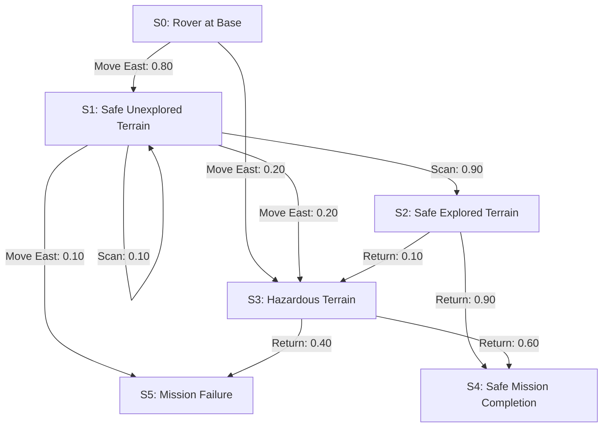

# Representation-of-a-Real-World-Problem-as-a-Markov-Decision-Process

## Aim

To model an autonomous lunar rover exploring and mapping the Moon's surface as a Markov Decision Process (MDP) by defining its states, actions, transition probabilities, rewards, and implementing the model using Python dictionaries.

## Problem Statement

An autonomous lunar rover is deployed on the Moon to explore and map unknown terrain. The rover must navigate across the lunar surface, avoid craters and hazardous regions, conserve battery power, and collect mapping data efficiently.

The rover uses reinforcement learning to select actions that maximize the area explored while minimizing energy consumption and the risk of entering dangerous terrain. The problem is represented as an MDP to model sequential decision-making under uncertainty.

### Problem Description

A lunar rover is designed to explore and map the surface of the Moon autonomously. The rover must navigate through different terrains, scan unexplored areas, avoid hazardous regions, and manage its limited battery power. The problem is modeled as a Markov Decision Process (MDP), where the rover selects actions based on its current position, terrain conditions, battery level, and mapping status. Each action leads to a possible new state and provides a reward or penalty. The objective is to find an optimal policy that maximizes the total reward by mapping as much of the Moon's surface as possible while avoiding hazards and returning safely to its base.

## MDP Components

A Markov Decision Process is represented as:

$$
MDP = (S, A, P, R, \gamma)
$$

Where:

| Symbol | Meaning |
|---|---|
| \(S\) | Set of states |
| \(A\) | Set of actions |
| \(P\) | Transition probability function |
| \(R\) | Reward function |
| \(\gamma\) | Discount factor |

---

## State Space

The state space represents all possible situations in which the lunar rover can exist during its mission. Each state describes the rover's location, terrain condition, mapping status, and battery condition.

For simplicity, the following discrete states are considered:

```text
S = {
    S0: Rover at base with full battery,
    S1: Rover in safe unexplored terrain,
    S2: Rover in safe explored terrain,
    S3: Rover in hazardous terrain,
    S4: Rover has returned safely to base,
    S5: Mission failed due to battery depletion or severe hazard
}
```

### State Descriptions

| State | Description |
|---|---|
| S0 | The rover is at its base and ready to explore. |
| S1 | The rover is exploring safe, unmapped terrain. |
| S2 | The rover is in terrain that has already been mapped. |
| S3 | The rover has entered a hazardous region. |
| S4 | The rover has completed the mission and returned safely to base. |
| S5 | The mission has failed due to battery depletion or a severe hazard. |

States \(S4\) and \(S5\) are terminal states, meaning the mission ends when either state is reached.

---

## Sample State

A sample state is:

```text
S1 = Rover in safe unexplored terrain
```

In this state, the rover is away from its base, has sufficient battery power, and is positioned in an unexplored area. It can scan the terrain to collect mapping data, move to another location, or return to base.

Example state representation using a dictionary:

```python
sample_state = {
    "position": "unexplored_region",
    "terrain": "safe",
    "mapping_status": "unmapped",
    "battery": "sufficient"
}

print(sample_state)
```

---

## Action Space

The action space defines all possible actions the rover can perform during its mission.

```text
A = {
    A0: Move East,
    A1: Move West,
    A2: Move North,
    A3: Move South,
    A4: Scan Terrain,
    A5: Return to Base,
    A6: Recharge Battery
}
```

### Action Descriptions

| Action | Description |
|---|---|
| A0 | Move east to a neighboring region. |
| A1 | Move west to a neighboring region. |
| A2 | Move north to a neighboring region. |
| A3 | Move south to a neighboring region. |
| A4 | Scan the current region and collect mapping data. |
| A5 | Navigate toward the base for safe return. |
| A6 | Recharge the battery when the rover is at a charging base. |

The rover chooses an action based on its current state and the expected reward.

---

## Sample Action

A sample action is:

```text
A4 = Scan Terrain
```

When the rover selects this action in an unexplored and safe region, it attempts to collect surface data and update the mapping status.

Example:

```python
current_state = "S1"
action = "Scan Terrain"

print("Current State:", current_state)
print("Selected Action:", action)
```

---

## Transition Probability

The transition probability describes the likelihood of moving from one state to another after an action is performed.

The general form is:

$$
P(s' \mid s,a)
$$

Where:

- \(s\) is the current state.
- \(a\) is the selected action.
- \(s'\) is the next state.

For example, when the rover moves east from the base, it may reach safe unexplored terrain or encounter a hazardous region.

The following probabilities are illustrative assumptions for this simplified model, not measured lunar mission data.

| Current State | Action | Next State | Probability |
|---|---|---|---:|
| S0 | Move East | S1 | 0.80 |
| S0 | Move East | S3 | 0.20 |
| S1 | Scan Terrain | S2 | 0.90 |
| S1 | Scan Terrain | S1 | 0.10 |
| S1 | Move East | S1 | 0.70 |
| S1 | Move East | S3 | 0.20 |
| S1 | Move East | S5 | 0.10 |
| S2 | Return to Base | S4 | 0.90 |
| S2 | Return to Base | S3 | 0.10 |
| S3 | Return to Base | S4 | 0.60 |
| S3 | Return to Base | S5 | 0.40 |

For each current state and action, the probabilities of all possible next states must sum to 1.

For example:

$$
P(S1 \mid S0,\text{Move East}) = 0.80
$$

This means there is an assumed 80% probability that the rover will move from the base to safe unexplored terrain when it chooses to move east.

---

## Reward Function

The reward function provides feedback to the rover for its actions and the resulting state. Positive rewards encourage useful behavior, while negative rewards discourage dangerous or inefficient actions.

The general form is:

$$
R(s,a,s')
$$

### Reward Table

| Situation | Reward |
|---|---:|
| Successfully scan unexplored terrain | +20 |
| Move into safe unexplored terrain | +10 |
| Move through already mapped terrain | +2 |
| Successfully return to base | +30 |
| Consume battery power | -2 |
| Enter hazardous terrain | -15 |
| Mission failure | -100 |

These reward values are illustrative and can be adjusted during reinforcement-learning experiments.

The objective is to maximize the expected cumulative discounted reward:

$$
G_t = \sum_{k=0}^{\infty} \gamma^k R_{t+k+1}
$$

Where \(\gamma\) is the discount factor, with:

$$
0 \leq \gamma \leq 1
$$

A discount factor closer to 1 gives more importance to future rewards.

---

## Graphical Representation

The following diagram illustrates the simplified MDP and its possible transitions.



**Interpretation:**

- Each node represents a state of the lunar rover.
- Each arrow represents a possible state transition caused by an action.
- The probability labels indicate the likelihood of the corresponding transition.
- Rewards are assigned to transitions according to the reward function.
- \(S4\) and \(S5\) represent terminal states.

---

## Python Representation

The following Python program represents the MDP using dictionaries. It defines the state space, action space, transition probabilities, reward function, and discount factor.

```python
# Representation of a Real-World Problem as a Markov Decision Process
# Problem: Autonomous Lunar Rover

print("Name: S Rohith")
print("Register Number: 212225240121")
print()

# 1. State Space
states = {
    "S0": "Rover at base with full battery",
    "S1": "Safe unexplored terrain",
    "S2": "Safe explored terrain",
    "S3": "Hazardous terrain",
    "S4": "Mission completed; rover returned safely",
    "S5": "Mission failed"
}

# 2. Action Space
actions = {
    "A0": "Move East",
    "A1": "Scan Terrain",
    "A2": "Return to Base",
    "A3": "Recharge Battery"
}

# 3. Transition Probability Function
# Format: current_state -> action -> [(next_state, probability)]

transitions = {
    "S0": {
        "Move East": [
            ("S1", 0.80),
            ("S3", 0.20)
        ]
    },

    "S1": {
        "Scan Terrain": [
            ("S2", 0.90),
            ("S1", 0.10)
        ],
        "Move East": [
            ("S1", 0.70),
            ("S3", 0.20),
            ("S5", 0.10)
        ],
        "Return to Base": [
            ("S4", 0.90),
            ("S3", 0.10)
        ]
    },

    "S2": {
        "Return to Base": [
            ("S4", 0.90),
            ("S3", 0.10)
        ],
        "Move East": [
            ("S2", 0.80),
            ("S3", 0.15),
            ("S5", 0.05)
        ]
    },

    "S3": {
        "Return to Base": [
            ("S4", 0.60),
            ("S5", 0.40)
        ]
    },

    # Terminal states have no outgoing actions.
    "S4": {},
    "S5": {}
}

# 4. Reward Function
# Format: (current_state, action, next_state): reward

rewards = {
    ("S0", "Move East", "S1"): 10,
    ("S0", "Move East", "S3"): -15,

    ("S1", "Scan Terrain", "S2"): 20,
    ("S1", "Scan Terrain", "S1"): -2,

    ("S1", "Move East", "S1"): 10,
    ("S1", "Move East", "S3"): -15,
    ("S1", "Move East", "S5"): -100,

    ("S1", "Return to Base", "S4"): 30,
    ("S1", "Return to Base", "S3"): -15,

    ("S2", "Return to Base", "S4"): 30,
    ("S2", "Return to Base", "S3"): -15,

    ("S2", "Move East", "S2"): 2,
    ("S2", "Move East", "S3"): -15,
    ("S2", "Move East", "S5"): -100,

    ("S3", "Return to Base", "S4"): 30,
    ("S3", "Return to Base", "S5"): -100
}

# 5. Discount Factor
gamma = 0.9

# 6. MDP Representation
mdp = {
    "states": states,
    "actions": actions,
    "transitions": transitions,
    "rewards": rewards,
    "gamma": gamma
}

# 7. Display MDP Components
print("=== LUNAR ROVER MDP ===")

print("\nState Space:")
for state, description in states.items():
    print(state, ":", description)

print("\nAction Space:")
for action, description in actions.items():
    print(action, ":", description)

print("\nTransition Probabilities:")
for current_state, action_data in transitions.items():
    for action, outcomes in action_data.items():
        for next_state, probability in outcomes:
            print(
                current_state,
                "--", action, "-->",
                next_state,
                "| Probability:", probability
            )

print("\nReward Function:")
for transition, reward in rewards.items():
    print(transition, ":", reward)

print("\nDiscount Factor:", gamma)

# 8. Sample Transition and Reward
current_state = "S1"
selected_action = "Scan Terrain"

print("\nSample State:", current_state)
print("Selected Action:", selected_action)
print("Possible Outcomes:", transitions[current_state][selected_action])

print("\nMDP representation created successfully.")
```

---

## Output

The output will display the state space, action space, transition probabilities, reward function, discount factor, and a sample action.

```text
Name: S Rohith
Register Number: 212225240121

=== LUNAR ROVER MDP ===

State Space:
S0 : Rover at base with full battery
S1 : Safe unexplored terrain
S2 : Safe explored terrain
S3 : Hazardous terrain
S4 : Mission completed; rover returned safely
S5 : Mission failed

Action Space:
A0 : Move East
A1 : Scan Terrain
A2 : Return to Base
A3 : Recharge Battery

Transition Probabilities:
S0 -- Move East --> S1 | Probability: 0.8
S0 -- Move East --> S3 | Probability: 0.2
S1 -- Scan Terrain --> S2 | Probability: 0.9
S1 -- Scan Terrain --> S1 | Probability: 0.1
S1 -- Move East --> S1 | Probability: 0.7
S1 -- Move East --> S3 | Probability: 0.2
S1 -- Move East --> S5 | Probability: 0.1
...
Discount Factor: 0.9

Sample State: S1
Selected Action: Scan Terrain
Possible Outcomes: [('S2', 0.9), ('S1', 0.1)]

MDP representation created successfully.
```

*The output above is abbreviated. The program prints all defined transitions and rewards; the exact register number depends on the value entered in the code.*

---

## Result

The autonomous lunar rover exploration problem was successfully modeled as a Markov Decision Process using Python dictionaries. The state space, action space, transition probabilities, reward function, and discount factor were defined. The model demonstrates how an autonomous rover can make sequential decisions under uncertainty while exploring unknown lunar terrain, avoiding hazards, conserving resources, and returning safely to its base.

The MDP representation can serve as a foundation for implementing reinforcement-learning algorithms such as Value Iteration, Policy Iteration, or Q-Learning to determine an optimal exploration policy.
