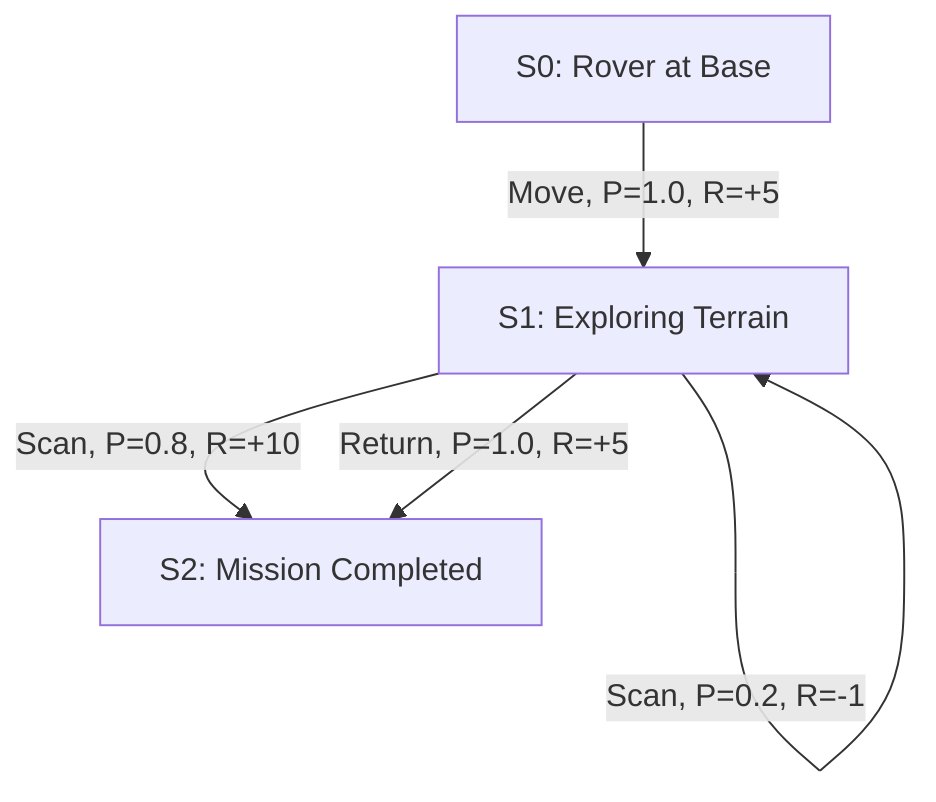

# Representation-of-a-Real-World-Problem-as-a-Markov-Decision-Process

## Aim

To model an autonomous lunar rover exploring and mapping the Moon's surface as a Markov Decision Process (MDP) by defining its states, actions, transition probabilities, rewards, and implementing the model using Python dictionaries.

## Problem Statement

An autonomous lunar rover is deployed on the Moon to explore and map unknown terrain. The rover must navigate the lunar surface, scan unexplored areas, and return safely to its base.

The problem is represented as an MDP to model sequential decision-making under uncertainty. The objective is to maximize the reward obtained from exploring and mapping the Moon's surface.

### Problem Description

A lunar rover is designed to explore and map the Moon's surface autonomously. It moves to unexplored terrain, scans the region to collect mapping data, and returns safely after completing its exploration. The MDP represents the rover's possible states, available actions, transition probabilities, and rewards.

## MDP Components

A Markov Decision Process is represented as:

$$
MDP = (S, A, P, R, \gamma)
$$

Where:

| Symbol | Meaning |
|---|---|
| \(S\) | Set of states |
| \(A\) | Set of actions |
| \(P\) | Transition probability function |
| \(R\) | Reward function |
| \(\gamma\) | Discount factor |

---

## State Space

The state space represents the possible situations of the lunar rover.

```text
S = {
    S0: Rover at base,
    S1: Exploring unexplored terrain,
    S2: Mission completed
}
```

### State Descriptions

| State | Description |
|---|---|
| S0 | The rover is at its base, ready to explore. |
| S1 | The rover is exploring unexplored terrain. |
| S2 | The rover has completed its mission and returned safely. |

---

## Sample State

A sample state is:

```text
S1 = Exploring unexplored terrain
```

In this state, the rover can scan the terrain to collect mapping data or return to its base.

```python
sample_state = "S1"
print("Sample State:", sample_state)
```

---

## Action Space

The action space defines the actions available to the rover.

```text
A = {
    A0: Move,
    A1: Scan,
    A2: Return
}
```

### Action Descriptions

| Action | Description |
|---|---|
| A0 | Move to unexplored terrain. |
| A1 | Scan the terrain and collect mapping data. |
| A2 | Return safely to base. |

---

## Sample Action

A sample action is:

```text
A1 = Scan
```

The rover scans the current terrain to collect mapping data.

```python
current_state = "S1"
action = "Scan"

print("Current State:", current_state)
print("Selected Action:", action)
```

---

## Transition Probability

The transition probability describes the probability of moving from one state to another after an action is performed.

The general form is:

$$
P(s' \mid s,a)
$$

Where:

- \(s\) is the current state.
- \(a\) is the selected action.
- \(s'\) is the next state.

### Transition Table

| Current State | Action | Next State | Probability |
|---|---|---|---:|
| S0 | Move | S1 | 1.0 |
| S1 | Scan | S1 | 0.2 |
| S1 | Scan | S2 | 0.8 |
| S1 | Return | S2 | 1.0 |

The probabilities for each state-action pair sum to 1.

For example:

$$
P(S2 \mid S1,\text{Scan}) = 0.8
$$

This means that scanning the unexplored terrain has an assumed 80% probability of completing the mission in this simplified model.

---

## Reward Function

The reward function defines the feedback received by the rover after taking an action.

The general form is:

$$
R(s,a,s')
$$

### Reward Table

| Current State | Action | Next State | Reward |
|---|---|---|---:|
| S0 | Move | S1 | +5 |
| S1 | Scan | S1 | -1 |
| S1 | Scan | S2 | +10 |
| S1 | Return | S2 | +5 |

Positive rewards encourage exploration and mission completion. A negative reward represents the cost of an unsuccessful scan.

The objective is to maximize the cumulative discounted reward:

$$
G_t = \sum_{k=0}^{\infty}\gamma^k R_{t+k+1}
$$

The discount factor is:

$$
\gamma = 0.9
$$

---

## Graphical Representation



---

## Python Representation

The following Python program represents the MDP using dictionaries.

```python
# Representation of a Real-World Problem as an MDP
# Problem: Lunar Rover Exploration

print("Name: ROHITH")
print("Register Number: 212225240121")
print()

# 1. State Space
states = {
    "S0": "Rover at Base",
    "S1": "Exploring Unexplored Terrain",
    "S2": "Mission Completed"
}

# 2. Action Space
actions = {
    "A0": "Move",
    "A1": "Scan",
    "A2": "Return"
}

# 3. Transition Probabilities
transitions = {
    "S0": {
        "Move": [("S1", 1.0)]
    },
    "S1": {
        "Scan": [("S1", 0.2), ("S2", 0.8)],
        "Return": [("S2", 1.0)]
    },
    "S2": {}
}

# 4. Reward Function
rewards = {
    ("S0", "Move", "S1"): 5,
    ("S1", "Scan", "S1"): -1,
    ("S1", "Scan", "S2"): 10,
    ("S1", "Return", "S2"): 5
}

# 5. Discount Factor
gamma = 0.9

# 6. MDP Representation
mdp = {
    "states": states,
    "actions": actions,
    "transitions": transitions,
    "rewards": rewards,
    "gamma": gamma
}

# 7. Display MDP Components
print("=== LUNAR ROVER MDP ===")

print("\nState Space:")
for state, description in states.items():
    print(state, ":", description)

print("\nAction Space:")
for action, description in actions.items():
    print(action, ":", description)

print("\nTransition Probabilities:")
for state, action_data in transitions.items():
    for action, outcomes in action_data.items():
        for next_state, probability in outcomes:
            print(
                state, "--", action, "-->",
                next_state, "| Probability:", probability
            )

print("\nReward Function:")
for transition, reward in rewards.items():
    print(transition, ":", reward)

print("\nDiscount Factor:", gamma)

# 8. Sample Action
current_state = "S1"
selected_action = "Scan"

print("\nSample State:", current_state)
print("Selected Action:", selected_action)
print("Possible Outcomes:",
      transitions[current_state][selected_action])

print("\nMDP representation created successfully.")
```

---

## Output

```text
Name: ROHITH S
Register Number: 212225240121

=== LUNAR ROVER MDP ===

State Space:
S0 : Rover at Base
S1 : Exploring Unexplored Terrain
S2 : Mission Completed

Action Space:
A0 : Move
A1 : Scan
A2 : Return

Transition Probabilities:
S0 -- Move --> S1 | Probability: 1.0
S1 -- Scan --> S1 | Probability: 0.2
S1 -- Scan --> S2 | Probability: 0.8
S1 -- Return --> S2 | Probability: 1.0

Reward Function:
('S0', 'Move', 'S1') : 5
('S1', 'Scan', 'S1') : -1
('S1', 'Scan', 'S2') : 10
('S1', 'Return', 'S2') : 5

Discount Factor: 0.9

Sample State: S1
Selected Action: Scan
Possible Outcomes: [('S1', 0.2), ('S2', 0.8)]

MDP representation created successfully.
```

---

## Result

The lunar rover exploration problem was successfully represented as a Markov Decision Process using Python dictionaries. The model contains three states, three actions, four transitions, a reward function, and a discount factor. This simplified MDP demonstrates how the rover can explore terrain, collect mapping data, and complete its mission.
